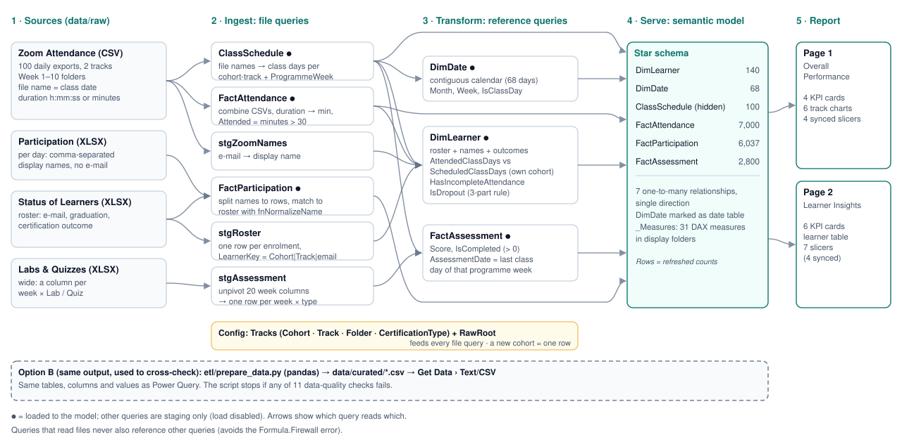
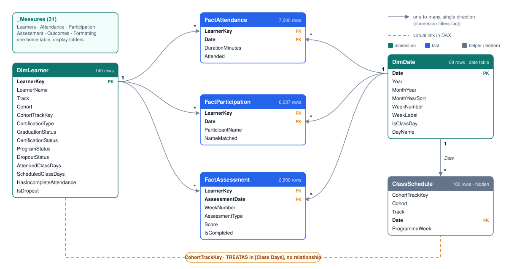
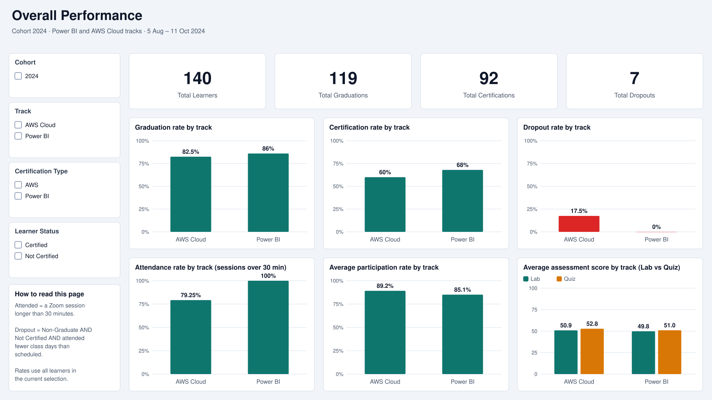
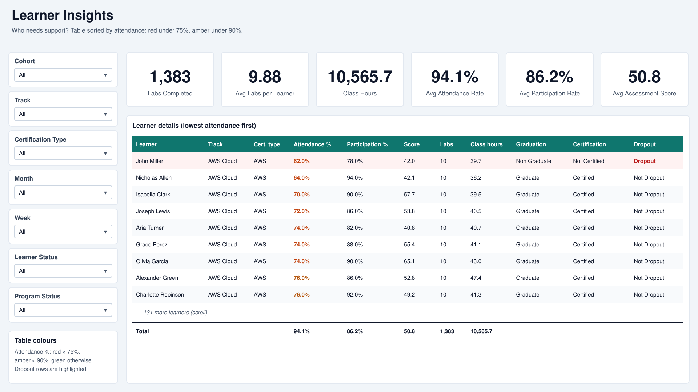

# Final report: Dare Careers Learner Progress pipeline and dashboard

| | |
| --- | --- |
| **Project** | Dare Careers: Learner Progress & Performance dashboard (Power BI lab) |
| **Author** | Fabrice Sheja |
| **Version / date** | 1.0 · November 2026 |
| **Status** | Final, submitted for review |
| **Tools** | Power BI Desktop 2.159 (Oct 2026), Power Query (M), DAX, PBIP project; Python 3.13 + pandas for cross-checking |

## 1. Executive summary

This lab required a two-page Power BI report on one learner cohort (2024) and its two tracks:
**Power BI** (100 learners) and **AWS Cloud** (40). The sources are 106 raw files in four formats,
and they share no learner ID. I loaded them with Power Query, reshaped each source to its natural
grain and applied the business rules from the brief and the mentor clarifications during
preparation. The result is a star-schema semantic model with 31 DAX measures. I also wrote a Python
ETL that builds the same tables and stops on 11 data-quality checks, and I used it to cross-check
the Power Query output.

| Graduation | Certification | Dropout | Attendance (> 30 min) | Participation | Avg score |
| --- | --- | --- | --- | --- | --- |
| **85.0%** (119) | **65.7%** (92) | **5.0%** (7, all AWS) | **94.1%** | **86.2%** | **50.8** / 100 |

**Main finding.** The two tracks graduate at similar rates (86.0% vs 82.5%), but attendance does
not: Power BI 100%, AWS Cloud 79.25%. All 7 dropouts are AWS Cloud learners who attended 31 to 45
of 50 classes. Low attendance is the early-warning signal, and page 2 ranks learners by it.

## 2. Scope and requirements

| Source of requirement | Requirement | Where it is met |
| --- | --- | --- |
| Lab brief | Page 1: 6 rate charts, 4 KPI cards, 4 slicers | §7, Figure 3 |
| Lab brief | Page 2: learner table, 6 KPI cards, 6 slicers | §7, Figure 4 |
| Lab brief | A session counts as attended only if it lasts **more than 30 minutes** (applies to all attendance figures) | `FactAttendance[Attended]`, §5 |
| Mentor clarification | Dropout = Non-Graduate **AND** Not Certified **AND** incomplete attendance | `DimLearner[IsDropout]`, §5 |
| Mentor clarification | Keep the Certification Type slicer (AWS / Power BI) | Slicer on both pages |
| Mentor clarification | One cohort now, but the model must **scale to future cohorts** | Cohort in every key, `ClassSchedule`, §8 |

Out of scope: publishing to the Power BI Service, row-level security, scheduled refresh.

## 3. Source data inventory

All raw files are stored unchanged in `data/raw/`, with one folder per track.

| Source | Format, volume | Grain | Quality issues found |
| --- | --- | --- | --- |
| Zoom Attendance | 100 CSV (50 per track) in `Week 1`–`Week 10` folders | one session per learner per class day | No date column: the date is in the file name (`05-Aug-2024.csv`). Duration is `h:mm:ss` for Power BI and minutes for AWS. 19 sessions last exactly 30 min. |
| Participation | 2 XLSX | one row per class day | Names are stored as one comma-separated text cell, with no e-mail. The same person can be listed twice on a day. |
| Labs & Quizzes | 2 XLSX | one row per learner | Wide layout: 20 columns (Week 1–10 × Lab / Quiz). 17 labs have a score of 0. |
| Status of Learners | 2 XLSX | one row per learner | Inconsistent file and sheet names. Graduation and certification outcomes are given as text. |

## 4. Pipeline architecture



_Figure 1. Data flow. Each arrow means that the query on the right reads the source or query on
the left. Option B (dashed) is the Python cross-check._

The pipeline has five layers:

1. **Configuration.** `RawRoot` holds the data folder path. `Tracks` lists one row per cohort ×
   track (folder, track, certification type). Every file query loops over `Tracks`, so the folder
   paths are written in one place only.
2. **Ingest (file queries).** These queries read the raw files and do row-level cleaning: combine
   the files, promote headers, set types, parse dates and durations, and build the keys. Staging
   queries (`stg*`) are not loaded into the model.
3. **Transform (reference queries).** `DimDate`, `DimLearner` and `FactAssessment` read only
   other queries, never a file. Keeping file access and query references in separate queries
   avoids Power BI's _Formula.Firewall_ error.
4. **Serve.** The semantic model is a star schema with measures (§6). Business rules that are
   fixed for each refresh (attended, dropout) are columns. Figures that must change with the
   slicers (rates, averages) are DAX measures.
5. **Present.** The two report pages, with the theme in `report/theme.json`.

**Reproducibility.** The Power Query code is kept as text in `powerquery/*.m` and the measures in
`model/measures.dax`. The report is saved as a PBIP project (`report/pbip/`) whose model is plain
TMDL files that can be compared line by line.

## 5. Transformations and business rules

| Output | Key transformations (Power Query) | Rows |
| --- | --- | --- |
| `ClassSchedule` | List the Zoom file names per cohort-track and parse the date from each name. `ProgrammeWeek` counts weeks from the Monday of that cohort-track's first class day. | 100 |
| `FactAttendance` | Combine the 100 CSVs and add `Date` from the file name. Convert the duration to decimal minutes (`h:mm:ss` and minutes handled separately). `Attended = DurationMinutes > 30`. Key = cohort, track and e-mail joined with a pipe. | 7,000 |
| `FactParticipation` | Split each day's name list into rows, then trim and remove duplicates per day. Match each name to the roster through `fnNormalizeName` (letters only, lower case). Unmatched names stay in the table with `NameMatched = 0`. | 6,037 |
| `stgAssessment` → `FactAssessment` | Unpivot the 20 week columns and split them into `WeekNumber` and `AssessmentType`. `IsCompleted = Score > 0`. `AssessmentDate` = the last class day of that week for the learner's own cohort-track. | 2,800 |
| `stgRoster` + `stgZoomNames` → `DimLearner` | One row per enrolment, with the outcomes and display names. `AttendedClassDays` is compared with `ScheduledClassDays`, which comes from the learner's own `ClassSchedule`. | 140 |
| `DimDate` | A contiguous calendar from the first to the last class day, with Month, `MonthYear` (sorted by `MonthYearSort`), Week and `IsClassDay` columns. Marked as the date table. | 68 |

| Business rule | Definition | Result |
| --- | --- | --- |
| Attended | Zoom session **> 30 minutes**. Exactly 30 does not count. | 6,585 of 7,000 learner-days |
| Incomplete attendance | `AttendedClassDays < ScheduledClassDays` | 40 learners (all AWS Cloud) |
| Dropout | Non-Graduate **AND** Not Certified **AND** incomplete attendance | **7** |
| Lab completed | Score recorded and > 0 (no pass mark in the source, so this is an assumption) | 1,383 of 1,400 |
| Attendance rate | Attended learner-days ÷ (learners × that learner's scheduled class days) | 94.1% |

**Why "incomplete" means attended < scheduled.** Every learner appears in every daily Zoom export,
so incomplete attendance can only show up as days below 30 minutes. A rule based on the last date
attended would hinge on a single class: it would flag someone at 45/50 who missed the final day.
The 14 Power BI non-graduates attended 50/50 classes, so they did not drop out; they finished the
course and did not pass.

## 6. Semantic model



_Figure 2. The semantic model. Two conformed dimensions filter three facts. Each fact is stored at
its own grain._

| Table | Grain (one row is…) | Key |
| --- | --- | --- |
| `DimLearner` | one enrolment of one learner in a cohort-track | `LearnerKey` (cohort, track and e-mail, pipe-joined) |
| `DimDate` | one calendar day | `Date` |
| `FactAttendance` | one Zoom session (here one per learner per class day) | `LearnerKey`, `Date` |
| `FactParticipation` | one learner listed as participating on one day | `LearnerKey`, `Date` |
| `FactAssessment` | one learner × week × Lab/Quiz | `LearnerKey`, `WeekNumber`, `AssessmentType` |
| `ClassSchedule` (hidden) | one class day of one cohort-track | `CohortTrackKey`, `Date` |

### Design decisions

- **Separate facts at their own grain.** One wide table would repeat each learner's outcome on
  every attendance and assessment row, so the totals would be multiplied.
- **Outcomes live on `DimLearner`.** Graduation and certification have one value per learner. As
  dimension columns, a "Not Certified" slicer filters the learner count and all three facts.
- **Seven one-to-many, single-direction relationships.** Filters always flow from dimension to fact.
  There are no bi-directional or fact-to-fact relationships.
- **`ClassSchedule` with `TREATAS`.** Rates must be divided by class days (50), not calendar days
  (68). Each cohort-track has its own schedule, so the denominator stays right when cohorts run on
  different dates. A relationship from learner to schedule would be many-to-many, so the
  `Class Days` measure passes the filter across with `TREATAS` instead:

```DAX
Class Days =
CALCULATE (
    DISTINCTCOUNT ( ClassSchedule[Date] ),
    TREATAS ( VALUES ( DimLearner[CohortTrackKey] ), ClassSchedule[CohortTrackKey] )
)
Attendance Rate = DIVIDE ( [Attended Learner Days], [Scheduled Learner Days] )   -- 94.1%
Total Dropouts =
CALCULATE (
    [Total Learners],
    DimLearner[GraduationStatus] = "Non Graduate",
    DimLearner[CertificationStatus] = "Not Certified",
    DimLearner[HasIncompleteAttendance] = 1
)                                                                                -- 7
```

All 31 measures live in a dedicated `_Measures` table, grouped into display folders. Each one is
listed with its expected value in `model/measures.dax`.

## 7. Report deliverable



_Figure 3. Page 1, Overall Performance: "How is the cohort doing?" Four KPI cards and six track
comparisons on fixed 0–100% axes, so small differences are not exaggerated._



_Figure 4. Page 2, Learner Insights: "Who needs support?" Six KPI cards and a learner table
sorted by attendance, with red/amber attendance colours and dropout rows highlighted. Figures 3
and 4 show the page layout with the values from a full refresh and no slicer selected._

- **Slicers.** Cohort, Track, Certification Type and Learner Status are synced across both pages.
  Month, Week and Program Status apply to page 2 only. No slicer uses a column from a fact table.
- **Design.** A custom theme (`report/theme.json`), the same grid on both pages, a short caption
  that states the business rules, and tooltips with the learner count.

## 8. Data quality, validation and reconciliation

**Automated checks.** `etl/prepare_data.py` stops with an error unless all 11 checks pass:

- unique `LearnerKey` and `Date`;
- no attendance or assessment rows for unknown learners;
- scores between 0 and 100;
- unique grain in the assessment, participation and schedule tables;
- every learner has a class schedule and every assessment has a date;
- every fact date exists in `DimDate`.

A further check confirms that each class day's computed week matches its `Week N` folder.

**Reconciliation.** Power Query (inside Power BI) and the Python ETL produce identical tables and
measure values:

| Check | Expected | Result |
| --- | --- | --- |
| Rows: DimLearner / DimDate / ClassSchedule | 140 / 68 / 100 | ✔ |
| Rows: FactAttendance / FactParticipation / FactAssessment | 7,000 (140 × 50) / 6,037 / 2,800 (140 × 10 × 2) | ✔ |
| Unmatched participation names | 0 | ✔ |
| Attendance rate: all / Power BI / AWS Cloud | 94.1% / 100% / 79.25% | ✔ |
| Total dropouts; Learner Status = Not Certified → learners | 7; 48 | ✔ |
| Oct 2024 filter: class days, attendance | 9; 94.0% | ✔ |

**Personal data.** E-mail addresses are hidden in the model; the report shows names only.

**Scalability test.** A second cohort was simulated (a 2025 AWS Cloud cohort that reuses the same
e-mail addresses), producing 180 learners. Keys stayed unique, each cohort-track was measured
against its own 50 class days, and the 2025 assessments were dated from February 2025. Adding a real
cohort means adding one row to `Tracks` plus its folder, then refreshing.

## 9. Limitations and next steps

| Limitation | Impact | Recommendation |
| --- | --- | --- |
| Participation is matched by name, not ID | Matching could fail on name changes (0 failures today; failures are kept and flagged) | Add e-mail or learner ID to the participation log |
| "Lab completed = score > 0" | 17 zero scores count as not done | Ask the programme for a pass mark or a submission flag |
| `DimDate` week numbers count from the first class day in the data | With overlapping cohorts, Week 1 is not each cohort's own Week 1 | Use the Week slicer together with the Cohort slicer |
| Program Status is always _Completed_ | The slicer has one value today | It works once an in-progress cohort is loaded |
| Local-file sources | A manual refresh is needed | Move `data/raw` to SharePoint and publish with scheduled refresh |

## 10. Deliverables

| Deliverable | Location |
| --- | --- |
| Power BI report (2 pages) | `report/DareCareers_Learner_Progress_Performance.pbix`, `report/pbip/` (project format) |
| Power Query transformations (12 queries) | `powerquery/*.m` |
| DAX measures (31) | `model/measures.dax` |
| Python ETL, validation and curated tables | `etl/prepare_data.py`, `data/curated/*.csv` |
| Theme | `report/theme.json` |
| This report (PDF) | `report/Final-Report.pdf` |
| Supporting documentation | `docs/`: [walkthrough](transformation-walkthrough.md), [data dictionary](data-dictionary.md), [model overview](model-overview.md), [report spec](report-spec.md), [issues and fixes](issues-and-fixes.md), [build guide](build-guide.md) |
